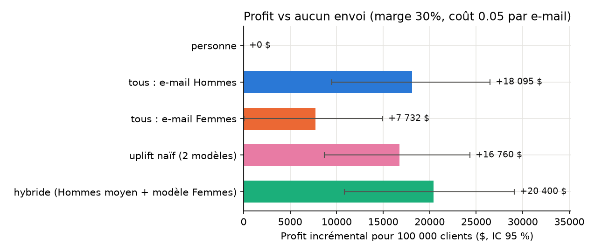
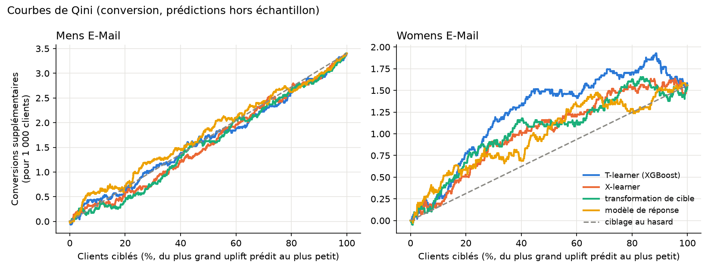

# CampaignLift — Measuring and targeting the causal effect of an e-mail campaign

[](https://github.com/mimouniahmed/CampaignLift/actions/workflows/tests.yml)

[](LICENSE)

[Français](README.md) · **English**

End-to-end analysis of a **randomized marketing experiment on 64,000 customers**. The work runs from protocol validation to an **ROI-quantified targeting recommendation**, through A/B testing, power analysis and uplift modeling.

**Business question**: is the e-mail campaign profitable, for which customers, and which e-mail should each customer receive?

## Key results

| | |
|---|---|
| **Decision** | Send the "Men's" e-mail to **all** customers |
| **Causal effect** | **+$0.77** revenue per customer (95% CI: [0.49, 1.05]); conversion rate × 2.2 |
| **Profitability** | **+$18,100 profit per 100,000 customers**, for $5,000 of sending costs (**ROI ≈ 3.6**) |
| **Validity range** | As long as the full cost of one e-mail stays below $0.77 × margin (≈ $0.23 at a 30% margin) |
| **Uplift targeting** | No demonstrable gain. The Men's e-mail effect is homogeneous. The Women's e-mail effect is heterogeneous and well modeled (Qini 0.30, p = 0.002), but the personalization gain (≈ +$2,300) is too small to be proven |

Assumptions behind the recommendation: 30% gross margin and $0.05 per e-mail. Both are tested on a sensitivity grid.



➡️ **[Executive report](docs/report.md)** (decision, figures, limitations) · **[Detailed methodology](docs/methodologie.md)** (in French)

## Technical highlights

- **Protocol validation before any estimation**
  - sample ratio mismatch test;
  - chi-square independence tests and standardized mean differences (love plot).
- **Robust inference on a zero-inflated metric** (99.1% of customers buy nothing)
  - Welch t-test validated by bootstrap;
  - Holm correction across 9 comparisons;
  - ANCOVA / CUPED adjustment assessed: negligible precision gain here, and the analysis explains why.
- **Corrected power analysis**
  - a Monte Carlo simulation shows that the textbook formula overstates power for rare events (74% actual vs. 80% claimed);
  - a corrected formula is derived and validated by simulation (80.6%).
- **Rigorously evaluated uplift models**
  - methods: S-, T- and X-learners, transformed outcome (XGBoost);
  - out-of-sample predictions via cross-fitting, Qini curves, permutation test against random ranking, decile calibration, stability across seeds;
  - **spurious heterogeneity detected**: for the Men's e-mail, the model predicts differences between customers that the data contradict.
- **Interpretability**: a surrogate tree summarizes the responsive segments, and raw observed uplift confirms them segment by segment.
- **Decision**
  - off-policy evaluation (Hájek IPW estimator) on the randomized data;
  - policy comparison with paired bootstrap, margin × cost sensitivity analysis;
  - cost of proof computed for personalization.
- **Engineering**: Python package, command-line tool, 17 tests (unit tests and reproduction of the notebook results), GitHub Actions CI.

## Data

**Kevin Hillstrom — MineThatData E-Mail Analytics Challenge (2008)**, public dataset ([CSV](http://www.minethatdata.com/Kevin_Hillstrom_MineThatData_E-MailAnalytics_DataMiningChallenge_2008.03.20.csv)).

64,000 customers who purchased within the past year were randomly split into three equal groups for two weeks:
- **Men's** e-mail;
- **Women's** e-mail;
- **no e-mail** (control).

| Type | Columns |
|---|---|
| Covariates | `recency`, `history`, `mens`, `womens`, `zip_code`, `newbie`, `channel` |
| Treatment | `segment` |
| Outcomes | `visit`, `conversion`, `spend` |

## Approach

| Notebook | Content | Main result |
|---|---|---|
| [01 — Exploration](notebooks/01_exploration.ipynb) | Data quality, SRM, covariate balance | Randomization validated (p = 0.90; \|SMD\| ≤ 0.014) |
| [02 — A/B tests](notebooks/02_ab_tests.ipynb) | z-test, Welch + bootstrap, Holm, ANCOVA, heterogeneity | Significant effects; Men's e-mail wins; effect driven by more buyers, not bigger baskets |
| [03 — Power](notebooks/03_power_analysis.ipynb) | MDE, corrected formula, simulation, subgroups | MDE: visit +8%, conversion +39%, spend +50% |
| [04 — Uplift](notebooks/04_uplift_models.ipynb) | Meta-learners, Qini, permutation test, deciles, surrogate tree | Women's e-mail targetable; Men's e-mail homogeneous |
| [05 — Targeting & ROI](notebooks/05_targeting_roi.ipynb) | Off-policy evaluation, paired bootstrap, sensitivity | Men's e-mail to all: +$18,100 per 100,000 customers |

Notebooks, charts and the methodology document are written in French.

<p align="center">
  
</p>

## Installation and reproduction

```bash
git clone https://github.com/mimouniahmed/CampaignLift.git
cd CampaignLift
python -m venv .venv && source .venv/bin/activate   # Windows: .venv\Scripts\activate
pip install -r requirements.txt
pip install -e .

# Data (downloaded automatically by the command below if missing)
mkdir -p data && curl -L -o data/hillstrom.csv "http://www.minethatdata.com/Kevin_Hillstrom_MineThatData_E-MailAnalytics_DataMiningChallenge_2008.03.20.csv"

pytest                                    # 17 tests
campaignlift --marge 0.30 --cout 0.05     # replays the full analysis (margin, cost per e-mail)
```

Run the notebooks in order, 01 → 05. Notebook 04 writes `data/uplift_predictions.csv`, which notebook 05 reads.

## Structure

```
CampaignLift/
├── campaignlift/            # Python package
│   ├── data.py              # loading, covariates, treatment encoding
│   ├── experiment.py        # SRM, SMD, z-test, Welch, bootstrap
│   ├── power.py             # power, MDE, sample size (corrected formulas)
│   ├── uplift.py            # cross-fitted T-learner, Qini, permutation test
│   ├── policy.py            # off-policy evaluation, profit, paired bootstrap
│   └── cli.py               # `campaignlift` command
├── notebooks/               # detailed analysis, 01 → 05
├── tests/                   # unit tests + result reproduction
├── docs/
│   ├── report.md            # executive report (English)
│   ├── rapport.md           # executive report (French)
│   ├── methodologie.md      # detailed methodology (French)
│   └── figures/
└── .github/workflows/       # CI
```

## Stack

Python 3.12 · pandas · NumPy · SciPy · statsmodels · scikit-learn · XGBoost · Matplotlib · pytest · GitHub Actions

## Author

**Ahmed Mimouni** — [github.com/mimouniahmed](https://github.com/mimouniahmed)

## License

Released under the [MIT License](LICENSE). The Hillstrom dataset is public and is not redistributed in this repository.
