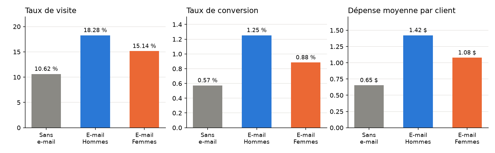
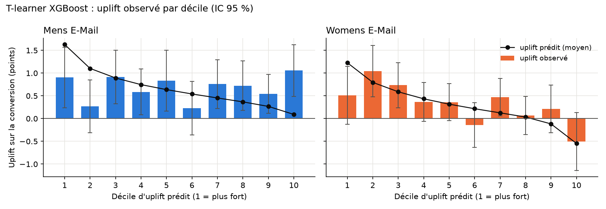
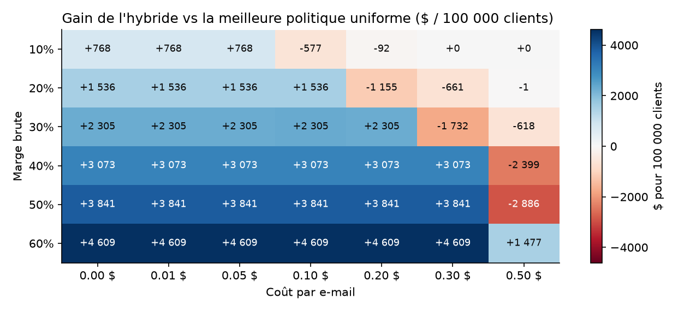

# CampaignLift — Executive report

[Français](rapport.md) · **English**

**Question**: is an e-mail campaign worth its sending cost, for which customers, and how much does it bring in?

**Short answer**: send the **Men's e-mail to all customers**. For 100,000 customers, this yields about **+$77,000 in revenue** and **+$18,100 in profit**, for $5,000 of sending costs (**ROI ≈ 3.6**). The recommendation holds as long as the full cost of one e-mail stays below $0.77 × margin, i.e. ≈ $0.23 at a 30% margin. Targeting the e-mail with uplift models **brings no demonstrable gain** on this data.

---

## 1. Data and protocol

The dataset is Kevin Hillstrom's randomized experiment (MineThatData, 2008). For two weeks, 64,000 customers who had purchased within the past year were randomly split into three groups: **Men's e-mail**, **Women's e-mail** and **no e-mail**. Three outcomes were measured: site visit, purchase (conversion) and amount spent.

**Randomization worked** (`notebooks/01_exploration.ipynb`):
- group sizes match the expected one-third split (χ² = 0.20, p = 0.90);
- all covariates are balanced: standardized mean differences ≤ 0.014, against a usual threshold of 0.1.

Differences between groups can therefore be read as **causal effects** of the e-mails.

One feature shapes the whole analysis: **99.1% of customers spend nothing** over the period. There are only 578 buyers, with baskets from $30 to $499.

## 2. Average effect of the e-mails

Source: `notebooks/02_ab_tests.ipynb`.

| vs. no e-mail | Men's e-mail | Women's e-mail |
|---|---|---|
| Visit | +7.7 pts (10.6% → 18.3%) | +4.5 pts |
| Conversion | +0.68 pt (0.57% → 1.25%, ×2.2) | +0.31 pt |
| **Spend per customer** | **+$0.77** [0.49, 1.05] | +$0.42 [0.17, 0.68] |

- **Statistical robustness**: all effects remain significant after Holm correction for 9 comparisons. Despite the heavy skew of spend, a bootstrap confirms the Welch t-test intervals.
- **Comparing the two e-mails**: the Men's e-mail beats the Women's e-mail, clearly on visits and conversion, narrowly on spend (p = 0.03).
- **Mechanism**: the e-mail works by **making more customers buy**, not by increasing the basket (≈ $114 in every group).
- **Covariates**: adjusting for them (ANCOVA / CUPED) reduces uncertainty by only 0.1 to 1.4%, because a customer's history predicts their two-week purchases very poorly.

## 3. What the experiment could detect

Source: `notebooks/03_power_analysis.ipynb`.

| Metric | Minimum detectable effect (80%, α = 5%) | Customers per group to detect +10% |
|---|---|---|
| Visit | +8% | ≈ 14,000 |
| Conversion | +39% | ≈ 290,000 |
| Spend | +50% | ≈ 500,000 |

- **The textbook formula is too optimistic**: it assumes equal variances and overstates power for rare events. A simulation gave 74% actual power where it claimed 80%. A corrected formula, validated by simulation, is used throughout.
- **Practical consequence**: run future tests on **visits**, which require 20 to 35 times fewer customers than spend.
- **Subgroups**: subgroup comparisons have little power (≈ 30%). A non-significant interaction proves nothing there.

## 4. Who does the e-mail actually influence?

Source: `notebooks/04_uplift_models.ipynb`.

**Uplift** models estimate the effect of the e-mail **customer by customer**: a response model as baseline, then S-, T- and X-learners and the transformed-outcome approach, all built on XGBoost. Evaluation uses out-of-sample predictions from 5-fold cross-fitting. Each model is compared against random rankings (permutation test), which is essential with such a weak signal.

- **Women's e-mail: heterogeneous effect, well captured.** The T-learner ranks customers much better than chance (p = 0.002). Targeting the 45% of customers with the highest predicted uplift captures almost the entire effect. The raw data confirm two findings:
  - the effect is **zero for customers who previously bought men's products and spent ≤ $500**, i.e. nearly half of the customer base;
  - it is strongest among **high-value customers** (> $500).
- **Men's e-mail: homogeneous effect.** No model beats chance. The model *predicts* differences between customers, but the *observed* effect is the same in every decile: those predicted differences are noise.

## 5. Decision and profitability

Source: `notebooks/05_targeting_roi.ipynb`.

**Assumptions** (the dataset only provides revenue):
- **30%** gross margin;
- full cost of **$0.05 per e-mail**: sending, creative work, and the cost of unsubscribes and customer fatigue.

Both assumptions are tested on a sensitivity grid.

**Policy evaluation**: each policy is evaluated on the randomized data without ever having been deployed. For each action, we look at the customers who received it at random. Intervals come from a paired bootstrap.

| Policy (100,000 customers) | Profit vs. no e-mail | vs. "Men's to all" |
|---|---|---|
| **All: Men's e-mail** | **+$18,100** [9,500, 26,500] | — |
| All: Women's e-mail | +$7,700 | −$10,400 (significant) |
| Naive uplift (two models) | +$16,800 | −$1,300 [−6,200, +4,000] |
| Hybrid (Men's average effect + Women's model) | +$20,400 | +$2,300 [−1,600, +6,700] |

Takeaways:
- **A poorly validated uplift model adds nothing.** The policy relying on both models does slightly worse than sending to everyone, because it exploits the noise of the Men's model.
- **The hybrid policy** keeps the model only where it is validated (the Women's e-mail, sent to 21% of customers). It gains ≈ +$2,300. But proving this gain would require ≈ 720,000 customers per arm: it is too small to be demonstrated.
- **Above the cost threshold** (≈ $0.23 per e-mail at a 30% margin), no policy beats sending nothing. No profitable niche was found.

## 6. Recommendation

1. **Send the Men's e-mail to all customers**, as long as cost per e-mail < $0.77 × margin.
2. **Do not target the Men's e-mail** with a model: its effect is the same for everyone.
3. **Optional**: send the Women's e-mail instead of the Men's e-mail to the ≈ 21% of customers the model rates as more responsive. Expected gain ≈ +$2,300 per 100,000 customers, not demonstrated. Only worth it if producing two e-mails costs nothing extra.
4. **No mass campaign** if the channel costs more than the threshold (direct mail, discount vouchers).
5. **Keep a control group of about 10%** in every campaign, to keep measuring the true effect.

## 7. Limitations

- **External economic assumptions**: margin and cost per e-mail do not come from the data; the sensitivity grid covers 10–60% margin and $0–0.50 cost.
- **Short horizon**: the effect is measured over **two weeks**. The long-term effect, whether loyalty or fatigue, is unknown.
- **Old data**: the data date from 2008; orders of magnitude should be revalidated on recent data.
- **Slightly optimistic evaluation of the hybrid policy**: it was designed after analyzing the same data.

---

*Reproduce*: `pip install -e .` then `campaignlift --marge 0.30 --cout 0.05`. The command replays the full analysis, and the tests (`pytest`) check that the package reproduces the figures in this report.

Charts are labeled in French.
